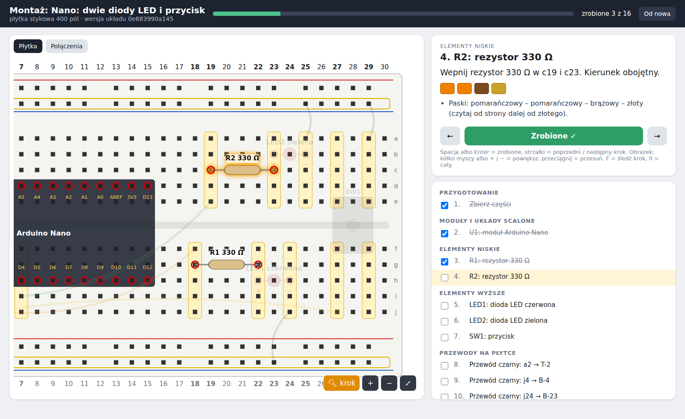
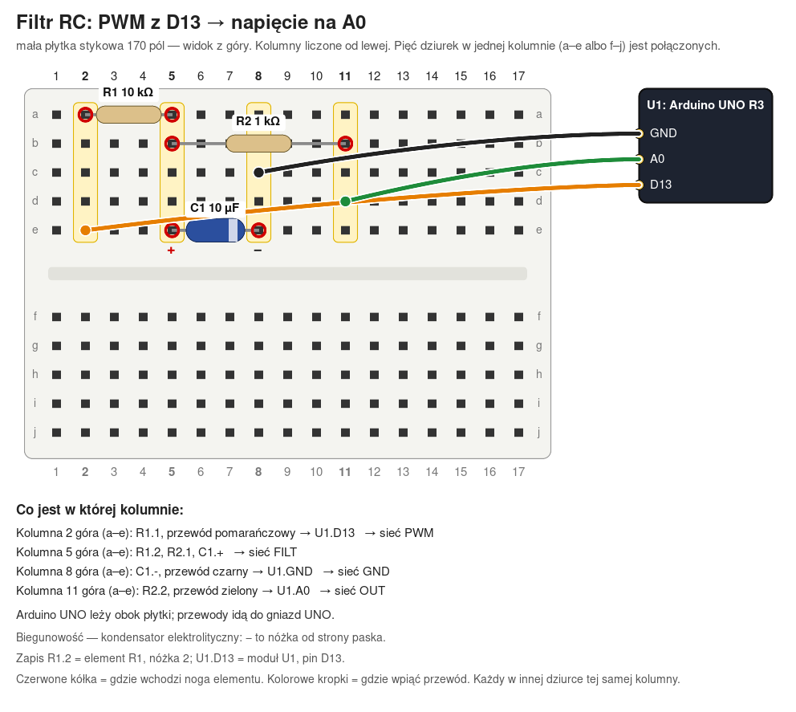
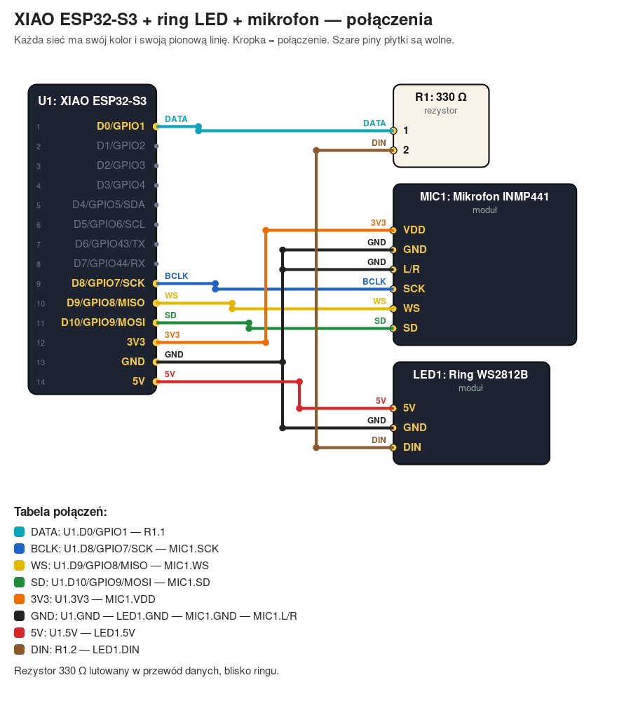
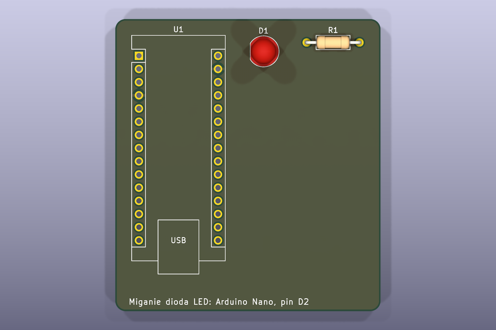

# hlbb — obrazek do budowy na stole, z kilkunastu linijek opisu

Piszesz krótki opis układu (co jest podłączone do czego, w którą dziurkę płytki stykowej) —
`hlbb` rysuje z niego gotowy do budowy obrazek płytki, sprawdza, czy połączenia się zgadzają,
i prowadzi przez montaż krok po kroku. Ten sam opis umie też zrobić schemat i płytkę PCB
w KiCadzie.

**Po co:** rysowanie płytki stykowej ręcznie (w Paincie, w Inkscape, kartka i linijka) jest
wolne i łatwo o pomyłkę — jedna zła dziurka i dioda się spala. `hlbb` sam pilnuje, żeby rysunek
zgadzał się z tym, co naprawdę ma być połączone, więc błąd wychodzi na ekranie, zanim wyjdzie
na płytce.



## Co potrafi

- **Rysuje płytkę stykową** z góry: elementy, kolorowe przewody, numery kolumn, legenda.
- **Rysuje połączenia modułów** kablami (bez płytki stykowej) — każda sieć w swoim kolorze.
- **Sprawdza połączenia** — zanim pokażesz obrazek komuś, kto ma z niego budować, `hlbb`
  porównuje go z opisem i zgłasza: brakujące połączenie, zwarcie, złą dziurkę.
- **Prowadzi przez montaż krok po kroku** (`montaz.html`) — jeden samodzielny plik, bez
  internetu: jedna czynność na krok, odhaczanie spacją, obrazek da się powiększyć i przesunąć,
  a bieżący element pulsuje na płytce.
- **Robi z tego samego opisu płytkę PCB** w KiCadzie — schemat, kontrola reguł (ERC/DRC),
  automatyczne trasowanie ścieżek, pliki gotowe do zamówienia u producenta (Gerbery) —
  opcjonalnie, potrzebuje Twojego komputera z KiCadem.
- **Mapa montażu gotowej płytki PCB** (`hlbb mapa`) — z pliku płytki KiCada albo EasyEDA robi
  jedną stronę HTML z listą części i obrazkiem płytki; klik w część oznacza tę jedną sztukę jako
  przylutowaną, a licznik u góry pokazuje, ile zostało.

| Obrazek płytki stykowej | Połączenia modułów kablami | Płytka PCB |
|---|---|---|
|  |  |  |

## Spis treści

| Rozdział | Co w nim jest |
|---|---|
| [01 — Instalacja](docs/01-instalacja.md) | czego potrzebujesz, jak zainstalować, pierwsze sprawdzenie |
| [02 — Pierwszy układ](docs/02-pierwszy-uklad.md) | krok po kroku: od pustego pliku do gotowego obrazka |
| [03 — Format opisu](docs/03-format-opisu.md) | ściąga: wszystkie elementy, płytki, zasady pisania opisu |
| [04 — Montaż krok po kroku](docs/04-montaz-krok-po-kroku.md) | co umie `montaz.html`: powiększanie, śledzenie kroku, klawiatura |
| [05 — Płytka PCB](docs/05-plytka-pcb.md) *(opcjonalnie)* | ten sam opis → schemat i płytka w KiCadzie |
| [05a — Mapa montażu płytki PCB](docs/05a-mapa-montazu-pcb.md) *(opcjonalnie)* | gotowa płytka PCB → klikalna lista części do lutowania |
| [06 — Integracja z własną aplikacją](docs/06-integracja.md) *(opcjonalnie)* | `assembly.json` i `breadboard-bare.svg` jako dane dla czegoś innego |
| [07 — Jak to działa](docs/07-jak-to-dziala.md) | budowa programu, decyzje projektowe, pułapki |
| [08 — Rozwiązywanie problemów](docs/08-problemy.md) | typowe błędy i co one znaczą |

## Najkrótsza droga (5 minut)

```bash
git clone https://github.com/<ty>/HobbyLab-breadboard
cd HobbyLab-breadboard
pip install -e .
hlbb render examples/nano_blink.py -o /tmp/probny
```

Kod wyjścia `0` i w `/tmp/probny/` plik `montaz.html` — otwórz go w przeglądarce. Jeśli to
zadziałało, instalacja jest gotowa; dalej [rozdział 02](docs/02-pierwszy-uklad.md) pokazuje,
jak napisać własny opis układu.

## Struktura repozytorium

```
hlbb/           kod narzędzia (biblioteka + CLI)
examples/       cztery gotowe przykłady (Arduino Nano, filtr RC, moduły na kablach)
docs/           rozdziały wymienione wyżej + obrazki
skill/pcb/      przykładowy skill dla Claude Code — jak agent może używać hlbb (do adaptacji)
tests/          testy automatyczne (pytest)
```

## Stan projektu

Działa i jest używane na co dzień: rysowanie płytki stykowej, połączeń kablami, sprawdzanie
i montaż krok po kroku (rozdziały 02–04). Płytka PCB (rozdział 05) też działa, ale
rozmieszczenie elementów jest proste (automatyczne pakowanie obok siebie) — do gęstej płytki
trzeba ręcznie przypiąć pozycje ważniejszych elementów. Biblioteka gotowych płytek (Arduino,
ESP32…) rośnie w miarę potrzeby — dopisanie nowej to kilka linijek (rozdział 03).
