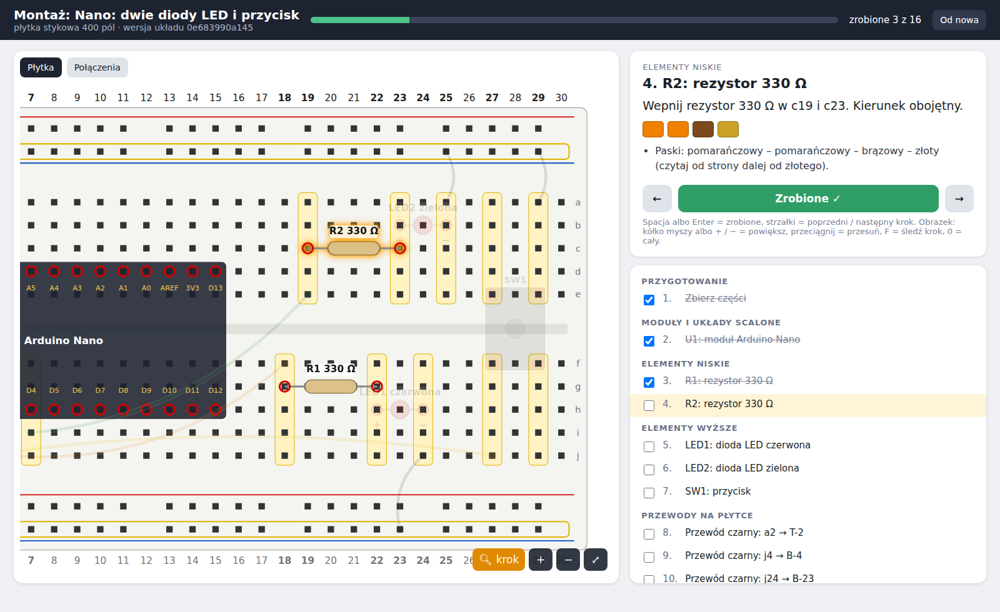

# 04 — Montaż krok po kroku

`montaz.html` to efekt końcowy, od którego warto zacząć — jeden samodzielny plik HTML,
bez żadnych zewnętrznych zasobów (żadnego internetu, żadnej instalacji), który można otworzyć
w przeglądarce na komputerze albo przesłać na telefon.

## Z czego się składa

- **Zakładki „Płytka” / „Połączenia”** u góry — obrazek płytki stykowej albo (jeśli układ nie
  ma płytki, tylko moduły na kablach) schemat połączeń.
- **Karta po prawej** z jednym bieżącym krokiem: co zrobić, opis elementu (np. paski
  kolorów rezystora, która nóżka LED jest dłuższa), duży zielony przycisk **„Zrobione ✓”**.
- **Lista wszystkich kroków** pod kartą, pogrupowana (przygotowanie, moduły, elementy niskie,
  elementy wyższe, przewody, kontrola przed zasilaniem) — można kliknąć dowolny krok, żeby
  do niego przeskoczyć, albo odhaczyć go bez przechodzenia do niego (pole wyboru z boku).
- **Pasek postępu i licznik** u samej góry („zrobione X z Y”).

## Powiększanie obrazka

Na dużej płytce (np. 830 otworów) pojedynczy krok bywa za mały, żeby cokolwiek odczytać —
dlatego obrazek daje się przybliżać:

| Akcja | Jak |
|---|---|
| Przybliż / oddal | kółko myszy nad obrazkiem, albo przyciski `+` / `−`, albo klawisze `+` / `-` |
| Przesuń | przeciągnij obrazek myszą (albo jednym palcem na telefonie) |
| Przybliż dwoma palcami | rozsuń/zsuń palce na telefonie (pinch-zoom) |
| Cały obrazek naraz | przycisk `⤢` albo klawisz `0` |
| **Śledź krok** | przycisk `🔍 krok` albo klawisz `F` — obrazek sam dociąga się do elementu bieżącego kroku, zawsze pokazując pełną wysokość płytki (nie ucina rzędów ani szyn zasilania) |

Na dużej płytce tryb „Śledź krok” jest włączony od razu. Zrobione kroki widać normalnie na
obrazku, bieżący element lekko pulsuje, a przyszłe kroki są przygaszone.

## Klawiatura (wygodne przy biurku)

| Klawisz | Działanie |
|---|---|
| Spacja / Enter | odhacz bieżący krok i przejdź do następnego nieodhaczonego |
| → / ↓ | następny krok (bez odhaczania) |
| ← / ↑ | poprzedni krok |
| + / - | przybliż / oddal obrazek |
| 0 | pokaż cały obrazek |
| F | włącz/wyłącz „Śledź krok” |

## Postęp i wersje

Odhaczenia zapisują się w przeglądarce (w jej lokalnej pamięci), przypisane do **wersji
układu** — to skrót pokazany pod tytułem strony („wersja układu …”), liczony z treści opisu.
Jeśli zmienisz `circuit.py` i wygenerujesz `montaz.html` ponownie, dostaniesz inny skrót i
postęp zacznie się od zera — to celowe: stare odhaczenia nie powinny udawać, że nowy,
zmieniony układ jest już zbudowany. Przycisk **„Od nowa”** w nagłówku czyści odhaczenia
ręcznie, bez zmiany opisu.

## Gdy układ nie przechodzi sprawdzenia

Jeśli `hlbb render` zgłosił błędy (kod wyjścia `1`), `montaz.html` i tak powstaje, ale zamiast
kroków i obrazka widać tylko czerwony komunikat z listą błędów. To zabezpieczenie: strona nie
pozwoli zbudować czegoś, co nie zostało jeszcze porządnie sprawdzone.

Dalej: [05 — Płytka PCB](05-plytka-pcb.md).
