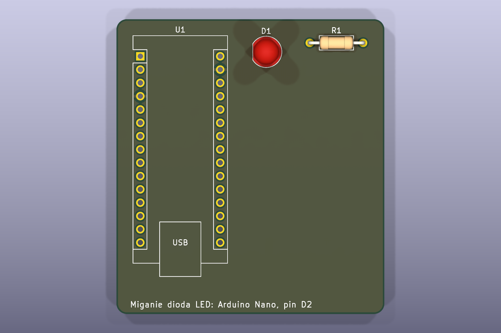

# 05 — Płytka PCB (opcjonalnie)

> Ten rozdział jest opcjonalny. Rysowanie płytki stykowej i montaż (rozdziały 02–04)
> działają bez niczego z tego, co niżej.

Ten sam opis układu, z którego powstał obrazek płytki stykowej, może też wygenerować
prawdziwy schemat elektroniczny i płytkę PCB w [KiCadzie](https://www.kicad.org/) — programie
do projektowania elektroniki. To wymaga osobnego komputera z zainstalowanym KiCadem 9
(darmowy, działa na Windows/macOS/Linux) — `hlbb` się tam łączy przez SSH i odpala tam gotowy
skrypt.



## Czego potrzebujesz na tamtym komputerze

- **KiCad 9** z `kicad-cli` dostępnym w terminalu (jest w standardowej instalacji) i modułem
  Pythona `pcbnew` (też standardowo, jeśli instalowałeś KiCada z Pythonem).
- **Java 21+** i **[Freerouting](https://github.com/freerouting/freerouting) 2.1.0**
  (plik `.jar`) — automatyczny program do prowadzenia ścieżek na płytce. Domyślna ścieżka,
  jakiej szuka `flow.sh`, to `~/tools/freerouting/fr-2.1.0.jar` — jeśli trzymasz go gdzie
  indziej, zmień tę linię w `hlbb/kicad_tpl/flow.sh` po stronie tamtego komputera.
- **`xvfb-run`** (Freerouting potrzebuje wyświetlacza, nawet żeby działać bez okna) i
  **`gerbv`** (podgląd plików dla producenta) — oba zwykle jedną linią z menadżera pakietów
  (`apt install xvfb gerbv` na Debianie/Ubuntu).
- **Logowanie po SSH kluczem** z komputera, na którym uruchamiasz `hlbb`, do tego z KiCadem —
  bez hasła wpisywanego ręcznie, bo `--run` łączy się z nim kilka razy pod rząd.

## Użycie

```bash
hlbb kicad circuit.py -o pcb/          # tylko design.py + generatory, nic nie wysyła
export HLBB_KICAD_HOST=user@twoj-komputer-z-kicadem
hlbb kicad circuit.py -o pcb/ --run    # + cały flow tam
```

Bez `HLBB_KICAD_HOST` ustawionego w zmiennych środowiskowych, `--run` odmawia zamiast
zgadywać, gdzie wysłać pliki — to celowe, żeby nikt przez pomyłkę nie wysłał danych na
niewłaściwy adres.

- `hlbb kicad` **odmawia**, jeśli `hlbb render` zgłasza błędy — płytki z niesprawdzonego
  układu nie robi.
- `--run` kopiuje katalog (przez `rsync`) na `$HLBB_KICAD_HOST:~/eda/<nazwa>/pcb/`. Tam
  uruchamia się `flow.sh`: schemat → kontrola reguł schematu (ERC) → płytka → Freerouting
  (prowadzenie ścieżek) → wylewka masy → kontrola reguł płytki (DRC) → paczka Gerberów (pliki,
  które przyjmie każda fabryka płytek, np. JLCPCB) → podglądy. Wyniki wracają z powrotem do
  `pcb/out/` na Twoim komputerze. Kod wyjścia `0` = kontrole ERC i DRC czyste.
- Po wygenerowaniu warto otworzyć płytkę w samym KiCadzie i obejrzeć ją na żywo, a potem
  zrobić test na papierze: wydrukować podgląd w skali 100% i sprawdzić szpilką, czy nóżki
  elementów trafiają we właściwe otwory, zanim zamówisz prawdziwą płytkę.

## Obudowy elementów

Domyślnie elementy dostają zwykłe, przewlekane obudowy — takie same proporcje jak na płytce
stykowej: rezystor (10,16 mm rozstawu), kondensator ceramiczny (5 mm) i elektrolityczny
(5 mm/2 mm), dioda (DO-35), LED (5 mm), przycisk (6 mm), układ DIP (0,3"/0,4"/0,6" rozstawu),
goldpiny (2,54 mm). Arduino Nano, UNO i WeMos D1 mini mają w KiCadzie prawdziwe,
sprawdzone obudowy tych płytek.

**Moduł bez obudowy w bibliotekach KiCada** (np. XIAO ESP32-S3, ESP32-S3 DevKitC, albo
własny `ModuleDef`) dostaje na płytce zwykłe złącze goldpin — tylko z pinami faktycznie
użytymi w układzie, podpisanymi na sitodruku — myśl o tym jako o miejscu na kabel do modułu,
nie o odwzorowaniu jego kształtu.

Chcesz inny symbol albo obudowę? Podaj je wprost:

```python
c.resistor("R1", "10k", kicad_symbol="Device:R",
           kicad_footprint="Resistor_SMD:R_1206_3216Metric")
```

(dla własnego modułu — te same argumenty w `ModuleDef(...)`). Numery pinów liczą się wtedy
po prostu z kolejności, w jakiej wymieniłeś nóżki w opisie (1, 2, 3…).

## Rozmieszczenie elementów na płytce

Automatyczne — elementy są pakowane obok siebie, a obrys płytki rysuje się dookoła całości.
To wystarcza do sprawdzenia, że układ w ogóle działa, ale nie da ładnej, gęstej płytki.
Żeby przypiąć konkretny element w konkretnym miejscu:

```python
c.pcb_place("U1", x_mm, y_mm, rot)
```

Jeśli poprawisz coś ręcznie bezpośrednio w KiCadzie (przesuniesz element na płytce), pamiętaj,
żeby tę samą zmianę przenieść z powrotem do opisu — kolejne `hlbb kicad` nadpisze plik KiCada
od zera, z samego opisu, i ręczna poprawka zniknie.

Dalej: [06 — Integracja z własną aplikacją](06-integracja.md).
